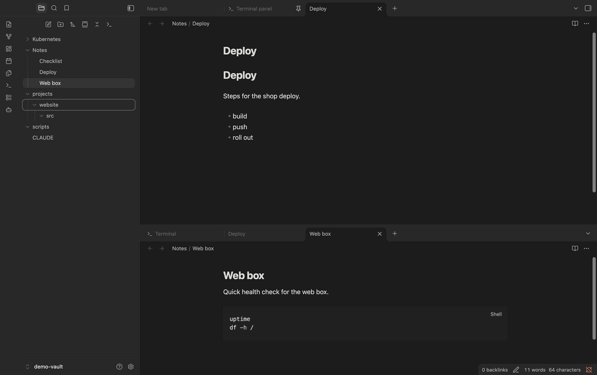
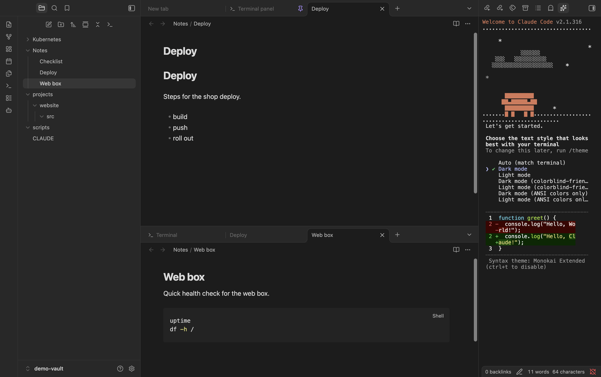
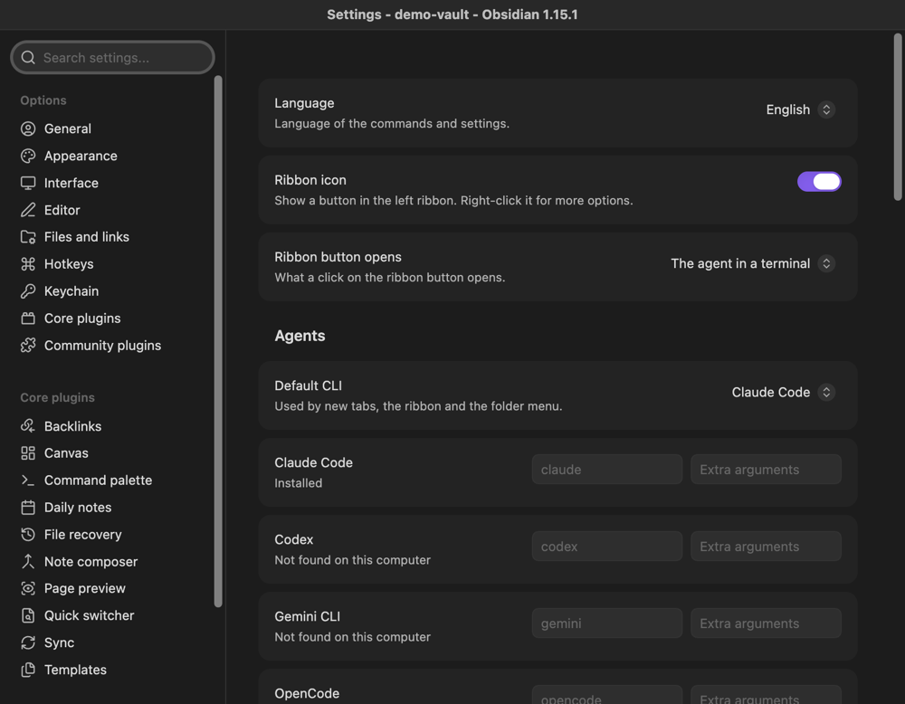

# ecu-ai

Run AI coding agents in your Obsidian sidebar. Click the ribbon button and Claude Code starts in a
real terminal next to your notes, in your vault folder. Open more tabs, switch to Codex, Gemini CLI or
another CLI, or start an agent in any folder on your computer.

No agent installed? The chat panel talks to the Claude API with your own API key, and works on
mobile too.



## Features

- **Starts right away**: the ribbon button opens your default CLI in the right sidebar. Click it
  again to come back to the same tab.
- **Multiple tabs**: run several agents side by side. New tabs open next to the last one.
- **Folder menu**: right-click a folder for **Open agent here** or **Open agent here (YOLO)**.
- **Send notes to the agent**: right-click a file, a folder or a selection (or use the commands) to
  type a reference such as `@Notes/Deploy.md (lines 3-8)` into the agent's prompt. You add the
  question. Open notes are saved first, so the agent reads your latest text. You can also drag files
  from the file explorer or your desktop into the terminal.
- **Projects outside the vault**: **Open agent in a project…** opens any folder. **Browse…** adds it
  to a list that's kept for next time. Pick the project, then the CLI, with the default on top. If
  only one CLI is installed, it starts right away.
- **Many CLIs**: Claude Code, Codex, Gemini CLI, OpenCode, GitHub Copilot CLI and Cursor Agent are
  built in. Add any other CLI or wrapper script under **Additional CLIs**.
- **YOLO mode** starts the agent without approval prompts (`--dangerously-skip-permissions` for
  Claude Code, the matching flag for the others). It asks for confirmation first, unless you turn
  that off.
- **Conversations continue**: tabs reopened after Obsidian restarts continue their last
  conversation. **Resume last conversation** does the same on demand.
- **Install help**: if a CLI isn't installed, the tab shows its install commands with a copy button.
- **Safe typing**: if the agent is showing a question (first-run setup, "trust this folder", a
  permission prompt), nothing is typed into it; the reference goes to the clipboard instead.
- **Shift+Enter** adds a new line in the agent's prompt.



## Commands

| Command | What it does |
| --- | --- |
| Open agent | Brings back the last agent tab, or opens one |
| New agent tab | Opens the default CLI in a new tab |
| New agent tab with another CLI… | Opens another CLI once, without changing the default |
| New agent tab (YOLO) | Opens the default CLI without approval prompts |
| Resume last conversation | Continues the last conversation in a new tab |
| Open agent in a project… | Opens an agent in a folder outside the vault |
| Switch default CLI… | Picks the CLI used by default |
| Toggle focus: editor ↔ agent | Jumps between the note and the agent |
| Close agent tab | Closes the current agent tab |
| Run agent in this note's folder | Starts an agent in the active note's folder |
| Send this file to the agent | Types a reference to the active note |
| Send the selection to the agent | Types a reference to the selected lines |
| Prepare this vault for AI agents | Adds AGENTS.md, CLAUDE.md and GEMINI.md (see below) |

No hotkeys are set by default; add your own under **Settings > Hotkeys**. Right-click the ribbon
button for the most common ones.

## Supported CLIs

| CLI | Command | YOLO flag | Resume |
| --- | --- | --- | --- |
| Claude Code (default) | `claude` | `--dangerously-skip-permissions` | `--continue` |
| Codex | `codex` | `--dangerously-bypass-approvals-and-sandbox` | `resume --last` |
| Gemini CLI | `gemini` | `--approval-mode=yolo` | `--resume latest` |
| OpenCode | `opencode` | (none) | `--continue` |
| GitHub Copilot CLI | `copilot` | `--allow-all` | `--continue` |
| Cursor Agent | `cursor-agent` | `--force` | `resume` |

Each one can use a different command (a full path, for example) and extra arguments such as
`--model sonnet`. Install the CLI you want and sign in to it once; ecu-ai starts it the same way
your own terminal would.

## Chat with an API key

- Add your key from [platform.claude.com](https://platform.claude.com/settings/keys) under **Chat
  with an API key**. The key is kept in Obsidian's keychain, not in the vault, so it doesn't travel
  with sync. Usage is billed to your Anthropic account; the panel shows the tokens each reply used.
- Claude can **list, search and read** notes, and **create, edit and append to** notes. Every
  change is shown first (what's removed, what's added) and only happens when you click Allow, unless
  you turn "Ask before changes" off or choose "Allow all in this chat".
- Edits replace one exact passage that must appear once in the note, so Claude can't accidentally
  rewrite the wrong part. Paths are checked to stay inside the vault, and `.obsidian/` is off limits.
- **Ask in chat about this note** attaches the note (and the selected lines) to your next message.
- Every reply has **Copy** and **Insert into note** buttons.
- Models: Claude Opus 5.5 (default), Claude Sonnet 5.5 or Claude Haiku 5.5, with a low / medium /
  high effort setting.



## Prepare the vault

**Prepare this vault for AI agents** adds:

- `AGENTS.md` with the vault's conventions: wikilinks, frontmatter, code blocks with a language,
  edit in place, write in the note's language, leave `.obsidian/` alone. Codex, OpenCode, Copilot
  and Cursor read it directly.
- `CLAUDE.md` and `GEMINI.md`, which import `AGENTS.md` for Claude Code and Gemini CLI.
- `.claude/settings.json` with a rule that stops Claude Code from editing `.obsidian/`.

Existing files are never overwritten.

## How it works

- The terminal is [xterm.js](https://xtermjs.org/) with [node-pty](https://github.com/microsoft/node-pty).
  node-pty is a small native module, so it isn't bundled: the first time you open an agent, ecu-ai
  downloads the build for your platform from this repository's releases and checks its SHA-256. If
  [ecu-terminal](https://github.com/erencanucarr/ecu-terminal) is installed, its copy is reused and
  nothing is downloaded.
- On macOS and Linux the agent starts through your login shell, so it gets the same `PATH` as your
  terminal. On Windows it starts through `cmd.exe`, or through WSL if you choose that in the
  settings; paths sent to an agent in WSL are converted to Linux paths.
- Supported: macOS, Linux and Windows (x64 and arm64). On mobile only the chat panel is available.

## Privacy

- In agent tabs ecu-ai makes no network requests itself, apart from the one-time node-pty download.
  The CLI you run talks to its own service.
- The chat panel sends your messages, and the notes you attach or Claude reads, to the Claude API
  at api.anthropic.com.
- To find installed CLIs, ecu-ai runs `command -v` for each built-in command in your shell
  (`where.exe` on Windows).

Claude Code is a product of Anthropic, Codex of OpenAI, Gemini CLI of Google, OpenCode of SST,
GitHub Copilot CLI of GitHub and Cursor Agent of Anysphere. This plugin isn't affiliated with any
of them.

## Install

1. From the [latest release](https://github.com/erencanucarr/ecu-ai/releases/latest), download
   `main.js`, `manifest.json` and `styles.css` into `<your vault>/.obsidian/plugins/ecu-claude/`.
   (The plugin started out as ecu-claude, and Obsidian keeps a plugin's ID for good, so the folder
   keeps that name.)
2. Enable **ecu-ai** under **Settings > Community plugins**.
3. Install at least one agent CLI, for example Claude Code:

   ```bash
   curl -fsSL https://claude.ai/install.sh | bash
   ```

The interface is in English and Turkish and follows Obsidian's language by default.

## License

MIT, see [LICENSE](LICENSE).
